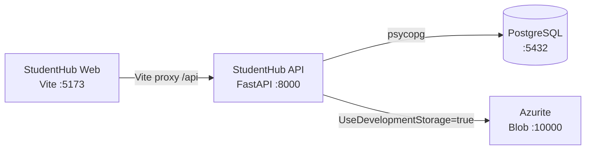

# Azure Debug Plan

> This plan is the source of truth for generating the
> VS Code debug setup in this workspace.
>
> **Status:** Implemented
> **Execution Mode:** Guided
> **Created:** 2026-11-22T12:14:13+05:30
> **Last Updated:** 2026-11-22T14:35:00+05:30
>
> <!-- Guided Mode (default) - hand-holds the user through review and approval before generating. -->

---

## Prerequisites

| Tool / Extension | Category | Service(s) | Installed | Version |
|------------------|----------|------------|-----------|---------|
| Python | Runtime | studenthub-api | ✅ | CPython 3.14.6 (`services/studenthub-api/.venv`) |
| pip | Package manager | studenthub-api | ✅ | 26.1.2 (Python 3.14) |
| pytest | Test runner | studenthub-api | ✅ | 9.2.0 |
| Node.js | Runtime | web | ✅ | v24.22.0 |
| npm | Package manager | web | ✅ | 11.19.1 |
| Docker | Container runtime | studenthub-api | ✅ | 29.9.3; engine reachable |
| Docker Compose | Compose provider | studenthub-api | ✅ | v5.7.0 |
| Podman | Alternate container runtime | studenthub-api | ❌ | Not installed or not available on PATH |
| Podman Compose | Alternate Compose provider | studenthub-api | ❌ | Not installed or not available on PATH |
| Microsoft Edge | Browser | web | ✅ | 158.0.4370.33 |
| ms-python.python | VS Code extension | studenthub-api | ✅ | 2026.10.0-win32-x64 |
| ms-python.debugpy | VS Code extension | studenthub-api | ✅ | 2026.6.0-win32-x64 |

> ✅ **Prerequisites rechecked:** 2026-11-22T14:01:49+05:30. Docker 29.9.3 and Docker Compose v5.7.0 are installed, and the Docker engine is reachable. Podman and Podman Compose are unavailable. The API virtual environment is present and was used for the Python, pip, and pytest checks.

---

## Debug Configurations

Each checked service produces a VS Code debug configuration in `.vscode/launch.json`.

| Generate | Debug Config Name | Service Label | Service Root | Project Type | Runtime | Version | Azure Dependencies |
|----------|--------------------|---------------|--------------|--------------|---------|---------|--------------------|
| [x] | StudentHub API (debug) | StudentHub API | ./services/studenthub-api | app-service | python | 3.14.6 | PostgreSQL, Azure Storage (Azurite) |
| [x] | StudentHub Web (debug) | StudentHub Web | ./services/web | frontend-spa | node-ts | 24.22.0 | — |
| [x] | Debug All Services | StudentHub All Services | — | *Compound Config* | — | — | — |

Project Type Descriptions

| Project Type | Description |
|-------------|-------------|
| app-service | FastAPI HTTP application launched locally with Uvicorn and the Python debugger. |
| frontend-spa | React single-page application served by the Vite development server and debugged in a browser. |

> ℹ️ **Proxy detected:** `services/web/vite.config.ts` proxies `/api` to `http://localhost:8000`. The compound configuration should start the API and its dependencies before the web frontend.
>
> The API debugger must use `services/studenthub-api/.venv/Scripts/python.exe`. Local API settings should use `ENVIRONMENT=Development`, PostgreSQL at `localhost:5432`, and `STORAGE_CONNECTION_STRING=UseDevelopmentStorage=true`; the existing `.env.example` contains development values.

---

## Orchestrator

| Orchestrator | Container Runtime | Compose Command | Description |
|-------------|-------------------|-----------------|-------------|
| Docker Compose | Docker | `docker compose` | Matches the existing `docker-compose.yml`; Docker and Compose still need to be installed and running. Preserve its current PostgreSQL and API services. Start only dependency containers for local debugging so the API container does not compete with the local debugger on port 8000. |

---

## Emulators

| Dependent Service | Emulator | Purpose |
|-------------------|----------|---------|
| PostgreSQL | PostgreSQL Container | Relational database required by the API at startup and for persisted account data. |
| Azure Storage | Azurite Container | Local Blob Storage endpoint selected by `UseDevelopmentStorage=true`. |

> Azure OpenAI appears as an optional enhancement in `.azure/project-plan.md`, but the current API has no Azure OpenAI SDK/client dependency and its provider returns local placeholder text. No Azure OpenAI emulator is available or planned for this local setup.
>
> The existing compose file already defines `postgres` and `api`; merge the Azurite service without replacing those definitions. Emulator startup should launch `postgres` and Azurite only. The local FastAPI debugger launches the API process.

---

## Architecture Diagram

The Edge-debugged Vite SPA proxies requests to local FastAPI, which connects to PostgreSQL and Azurite containers; Azure OpenAI remains outside the local dependency graph.

---

## Migrations

The API has an Alembic configuration and an initial schema revision. When selected, the generation phase creates a migration task so the local PostgreSQL schema is applied before API debugging.

| Generate | Service | Migration Tool |
|----------|---------|---------------|
| [x] | StudentHub API | Alembic |

---

## API Test Collections

When selected, the generation phase produces runnable smoke tests for the registered API endpoints.

| Generate | Service | Description |
|----------|---------|-------------|
| [x] | StudentHub API | 

HTTP Endpoints (10)
 GET /api/health POST /api/auth/register POST /api/auth/login GET /api/hostels GET /api/roommates/matches GET /api/mess/menu GET /api/marketplace/listings POST /api/uploads/presign GET /api/conversations POST /api/reports 
 |

---

## Convenience Scripts

Add these to the existing `services/web/package.json` scripts while preserving its current `dev`, `build`, `lint`, and `preview` commands.

| Generate | Script | Registered In | Description |
|----------|--------|---------------|-------------|
| [x] | emulators:start | ./services/web/package.json | Start PostgreSQL and Azurite in the background without starting the API container. |
| [x] | emulators:stop | ./services/web/package.json | Stop the dependency containers while preserving their data. |

---

## Debug Configuration Checklist

✅ StudentHub API (debug) — Uvicorn ready on 127.0.0.1:8000; `/api/health` returned 200 and `/api/hostels` returned 200
✅ StudentHub Web (debug) — Vite ready on 5173; `http://localhost:5173/` returned 200
✅ Debug All Services — terminal orchestration validated both services separately; duplicate API startup was removed after diagnosis; native VS Code compound attachment and breakpoint attachment remain unverified in this session
✅ PostgreSQL/Azurite — PostgreSQL became healthy, Azurite started, and Alembic completed the initial 20261122_0001 revision

> ✅ Final teardown — API process, Vite process, PostgreSQL, and Azurite stopped; Compose containers removed; ports 5432, 8000, 5173, 10000, 10001, and 10002 released
> ⚠️ Limited support — `.azure/vscode-debug-plan.md` declares `app-service`, but this workspace has no canonical `project-types/app-service.md`; FastAPI launch and task wiring used the Python runtime guidance and were validated through Uvicorn HTTP startup